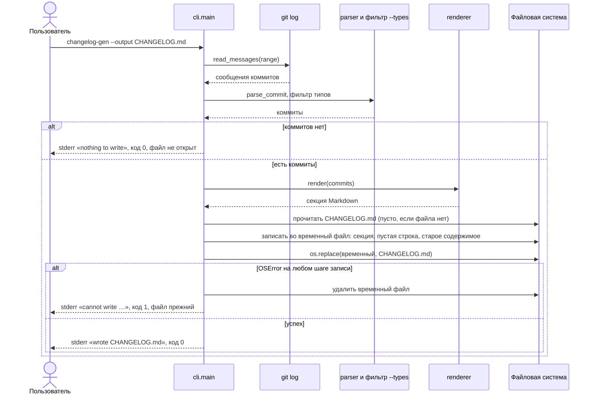

# Design

## Context

Мотивация — `proposal.md`, требования — `specs/changelog-cli/spec.md`. После `filter-commit-types` CLI разбирает аргументы через `argparse`, фильтрует коммиты и печатает `render()` в stdout. Записи в файлы в проекте пока нет.

## Goals / Non-Goals

**Goals:**
- Секция попадает в начало файла одной операцией, без частично записанного состояния.
- Текст секции в файле совпадает с тем, что печатается в stdout без `--output`.

**Non-Goals:**
- Блокировки при одновременном запуске двух процессов.
- Сохранение прав доступа и владельца файла сверх того, что даёт замена файла.

## Взаимодействие

Пользователь запускает `changelog-gen --output CHANGELOG.md`. CLI разбирает аргументы и, как и раньше, читает сообщения из `git log`, разбирает их парсером и отбрасывает лишние типы. Если после фильтра коммитов нет, CLI пишет в stderr `nothing to write` и завершается, не открывая файл. Иначе рендерер строит секцию, CLI читает текущее содержимое файла (пустая строка, если файла нет), склеивает «секция + пустая строка + старое содержимое» и записывает результат во временный файл в том же каталоге. Затем временный файл заменяет целевой через `os.replace`, и CLI печатает в stderr `wrote CHANGELOG.md`. Если на любом шаге записи возникает `OSError`, временный файл удаляется, целевой остаётся прежним, а CLI печатает `cannot write …` и возвращает код 1.

## Decisions

1. **Временный файл + `os.replace` в том же каталоге.** Замена атомарна на одной файловой системе (в том числе на Windows). Альтернатива — открыть целевой файл на запись и писать сразу: при сбое посередине файл окажется обрезанным, а это нарушает требование «Ошибка записи не портит файл».
2. **Кодировка UTF-8, перевод строк `\n` (`newline=""` при записи).** В проекте `.gitattributes` закрепляет LF; текстовый режим Windows иначе превратил бы всё в CRLF.
3. **Пустой результат проверяется до чтения файла.** Так файл не трогается вообще, и время изменения сохраняется.
4. **Запись — отдельная функция `prepend(path, text)`.** Её можно тестировать без git; CLI только решает, писать или печатать.

## Risks / Trade-offs

- [Повторный запуск добавит ту же секцию ещё раз] → Вне границ (proposal); пользователь видит `wrote` и diff в git.
- [`os.replace` создаёт новый файл: атрибуты исходного (например, read-only) не переносятся] → Для `CHANGELOG.md` в репозитории это не важно; записано как ограничение.
- [Временный файл остаётся при аварийном завершении процесса (kill)] → Имя с префиксом `.changelog-gen-`, в `.gitignore` не добавляем: случай редкий, файл виден в `git status`.
