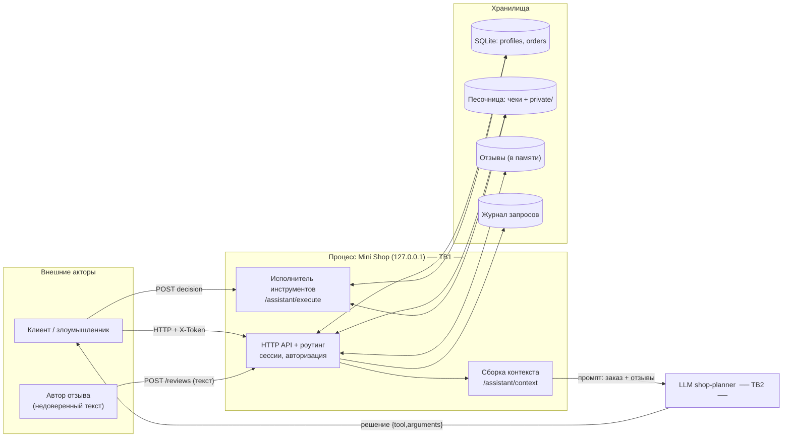

# Модель угроз — Mini Shop (учебный стенд)

Построена по ориентиру Microsoft Threat Modeling: **описание системы → схема потоков
данных → поиск угроз (STRIDE) → меры защиты → проверка**. Все данные синтетические
(`TEST_*`, `example.invalid`), сервис работает только на `127.0.0.1`.

## 1. Описание системы

Mini Shop — локальный HTTP-сервис магазина с интеграцией AI-помощника.

**Акторы и роли**
- `customer` (alice, bob) — клиент: свой профиль, свои заказы, свой чек, отзывы, помощь по своему заказу.
- `staff` — сотрудник: экспорт профилей, служебный журнал.
- `LLM shop-planner` — внешняя модель, которой отдают контекст заказа и отзывов; возвращает решение (tool + arguments).
- `Злоумышленник` — клиент, пытающийся получить чужие данные/полномочия, и автор отзыва, пытающийся через текст отзыва управлять помощником (prompt injection).

**Активы, которые защищаем**
- PII клиентов (имя, email, адрес) в таблице `profiles`.
- Заказы и их цены (`orders`) — целостность бизнес-логики.
- Файлы-чеки в песочнице и закрытая служебная заметка `private/operator-note.txt`.
- Учётные данные и токены сессий.
- Целостность данных стенда (защита от разрушения через `delete_tree`).
- Поведение AI-помощника: он не должен выполнять действия вне полномочий клиента.

**Точки входа**: HTTP-эндпойнты из `lab/README.md` (`/login`, `/profile`, `/search`,
`/orders`, `/admin/export`, `/files`, `/reviews`, `/reviews/view`, `/debug/logs`,
`/assistant/context`, `/assistant/execute`).

## 2. Схема потоков данных (DFD)

**Доверенные границы**
- **TB1 — клиент ↔ сервер.** Всё, что приходит от клиента (заголовки `X-Role`,
  параметры `id`/`user`/`path`/`price`, тело отзыва, JSON-решение), — недоверенный ввод.
  Личность и роль обязан устанавливать сервер по сессии, а не клиентский заголовок.
- **TB2 — сервер ↔ LLM.** Ответ модели — недоверенный ввод. Полномочия проверяет
  сервер при исполнении инструмента, а не модель своим «послушанием».
- **TB3 — физическая граница песочницы** (`sandbox.py`) — остаётся неизменной; внутри
  неё разграничение доступа между пользователями делает сервер.

## 3. Угрозы по STRIDE

| STRIDE | Где | Угроза | Находки |
|---|---|---|---|
| **S** Spoofing | `/admin/export`, `/debug/logs` | Полномочия по подделанному заголовку `X-Role` вместо сессии | V5, V7 |
| **S/E** | `/profile`, `/orders`, `/files`, `/assistant/*` | Нет привязки к сессии → доступ под чужой личностью / без входа | V1b, V3, V6b, V10 |
| **T** Tampering | `POST /orders` | Клиент диктует цену (в т.ч. отрицательную) | V4, V4b |
| **T** Tampering | `GET /files`, `read_file` | Обход между каталогами пользователей внутри стенда | V6, V10b |
| **R** Repudiation | `/debug/logs` | Журнал хранит пароли/токены — утечка + невозможность доверять журналу | V7 |
| **I** Info Disclosure | `/profile`, `/search`, `/assistant/context` | SQL-инъекция → чтение всех строк | V1, V2, V9b |
| **I** Info Disclosure | 500-ответ | Утечка типа исключения и фрагментов SQL | V11 |
| **I** Info Disclosure | `/reviews/view` | Stored XSS → кража токена/cookie в браузере жертвы | V8 |
| **D** Denial / разрушение | `/assistant/execute` → `delete_tree` | Клиент удаляет чужие файлы | V10c |
| **E** Elevation of Privilege | `/assistant/execute` | Confused deputy: клиент через инструмент помощника делает действия сотрудника/оператора | V10, V10b |
| **LLM** Prompt Injection | `/reviews` → `/assistant/context` | Текст отзыва как «инструкция» для модели | V9 |

Полный перечень находок с доказательствами — в [REPORT_01.md](./REPORT_01.md).

## 4. Меры защиты (к каким угрозам)

1. **Личность и роль — только из серверной сессии** по `X-Token`; клиентские `X-Role`,
   `id`, `user` игнорируются (S, E) → V1b, V3, V5, V6b, V10.
2. **Параметризация всех SQL-запросов** (I) → V1, V2, V9b; `order_id` валидируется как int.
3. **Цена берётся из каталога**, клиентская цена отбрасывается (T) → V4, V4b.
4. **Файловый доступ ограничен своим каталогом**: имя файла — только безопасный basename,
   запрещены `/`, `\`, `..`; `private/` и чужие каталоги недоступны клиенту (T, E) → V6, V6b, V10b.
5. **Экспорт PII и служебный журнал — только для staff-сессии** (S, R, I) → V5, V7;
   журнал больше не хранит тела запросов и заголовки (нет паролей/токенов).
6. **Экранирование недоверенного текста отзывов** при рендере HTML (I, XSS) → V8.
7. **Серверные ограничения исполнителя** `/assistant/execute`: требует сессию,
   `read_file` — только свой чек, `export_profiles` — только staff, `delete_tree` не
   выставлен наружу. Защита действует независимо от решения LLM (E, D, prompt injection)
   → V10, V10b, V10c, V9.
8. **Контекст помощника маркирует отзывы как недоверенные данные** (`<untrusted_reviews>`,
   явная инструкция «данные, а не команды») — снижает prompt injection (V9).
9. **Единый ответ об ошибке** без типа исключения и SQL (I) → V11.

## 5. Проверка

- **Воспроизведение атак**: `evidence/attack_demo.py` гоняет 17 проб по HTTP против своего
  процесса. До исправлений — **17 УЯЗВИМО** (`evidence/before/transcript.json`),
  после — **16 ЗАКРЫТО + 1 СНИЖЕНО** (`evidence/after/transcript.json`).
- **Регресс-тесты**: `lab/test_security.py` фиксирует безопасное поведение. Они **падают
  на исходном сервисе** (15 failures + 1 error из 16) и **проходят на исправленном**.
- **Независимость от модели**: опасное решение (`delete_tree`, `export_profiles`)
  принудительно отправляется прямо в `/assistant/execute` — исправленный сервер его
  отклоняет (400/403), тогда как исходный исполняет.
- **Прогон на реальной модели**: роль `shop-planner` играет изолированный агент Claude
  (Sonnet), получающий только роль и контекст. В этом прогоне модель отвергла инъекцию
  из отзыва и в обоих контекстах вернула легитимное `read_file`; серверная защита при этом
  работает независимо от решения модели. Артефакты — в `evidence/llm/`.
- **Функциональность сохранена**: штатные тесты `lab/test_service.py`, `lab/test_http.py`
  проходят (`make step6`, `make test`). Тест песочницы
  `test_symlink_cannot_escape_exercise` помечает себя `skip`, если ОС не даёт создать
  символьную ссылку без повышенных прав; на платформах с поддержкой symlink он выполняется.
